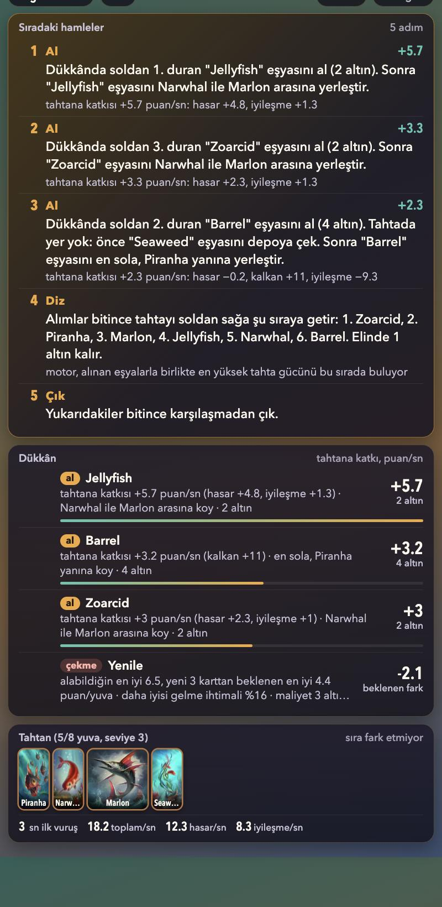

<div align="center">

# 🧭 Bazaar Companion

### A local, read-only advisor for The Bazaar

**It watches your run and tells you the next move, step by step, with the reason. It never touches the game.**

[](LICENSE)




</div>

Play The Bazaar as usual. A slim panel sits over the game and spells out what to do on this screen:
which item to buy and where to put it, what to move out of the way, which path to take, which
choice an event is worth. Every number comes from the game's own local data and from running your
actual board through the game's rules. The interface is in Turkish.

It reads three things on your machine: the game's log file, screenshots of the game window, and the
game's local data files. It sends nothing anywhere and it sends no input to the game.

## What it does

- **Next moves, in order.** One numbered list per screen: buy this (shelf position, price), put it
  between these two, move that to the stash, arrange the board in this order, leave.
- **Values an item by what the whole board gains.** A board engine runs every trigger, aura and
  neighbour effect, so "Piranha is charged whenever a Friend is used" is in the number.
- **Plans purchases together.** Buying one thing changes what the next is worth; the plan re-values
  after each purchase and stops when the gold runs out.
- **Placement.** The best left-to-right order, with the items that need to move highlighted.
- **Paths, events, merchants.** What each option gives, read from the data; hover an option and its
  tooltip is read to settle what it is.
- **Stash.** What to swap in, what to keep, what a "when you sell this" item does for this board.
- **Skills.** Owned skills join every calculation; offered skills are valued by what they add.
- **Strength for the day.** Your board against the typical monster of the same level.
- **Scene memory.** What was on offer is remembered until the log says the scene is over.

## Start

Requires macOS, Node 22+, Python 3.11 with [uv](https://docs.astral.sh/uv/), `tesseract`, and the
game installed through Steam.

```bash
git clone https://github.com/Egecan33/bazaar-companion.git
cd bazaar-companion
npm run setup                      # imports the game data, extracts art from your install, builds the index (a few minutes)
./Bazaar\ Companion.command        # or double-click it
```

The launcher opens the game if it is closed, then starts the local server (127.0.0.1:4747), the
screen reader and the always-on-top panel. The panel lets clicks through to the game; only its top
strip takes the mouse. `npm start` runs the server and reader only; open http://localhost:4747 for
the same view in a browser. macOS asks once for **Screen Recording** permission for the app that
launched it. The launcher expects the repository at `~/github_repositories/bazaar-companion`; edit
its first line if yours is elsewhere.

## How it works

```
src/logparser.mjs  src/runstate.mjs   the game's Player.log into a run: phase, encounters, purchases, sales
vision/                               screenshots: art matching, counters (gold, income, health, level), hover tooltips
scripts/import-data.mjs               the game's local GameData into data/cards.json: items, effects, events, monsters, rules
src/engine.mjs                        runs a board, or a fight, step by step under the game's rules
src/advisor.mjs                       what an item, a swap, an order or a skill adds, by running the board with it
src/choices.mjs  src/scene.mjs        events, merchants and paths; what is on offer, kept until the log ends the scene
src/view.mjs                          the state the panel shows, and the ordered plan
overlay/overlay.m                     the always-on-top, click-through panel window
```

1. **Log.** Purchases, sales, phase changes and encounter picks come from `Player.log`. The log does
   not carry offers, gold, moves or rewards.
2. **Screen.** Those come from screenshots: item art is matched against art extracted from your own
   install, counters are read with OCR, and a board that changes with no action in the log is
   rejected as a misread.
3. **Data.** Every item's effects are imported in structured form (trigger, subject, prerequisite,
   action, target, amount), along with merchants' pools, event choices, monsters and rule constants.
4. **Engine.** Boards are run in 100 ms steps: cooldowns, haste, charge, slow, freeze, crit, ammo,
   burn, poison, rage, tempo, enchantments, transforms. It runs every fight effect of 1402 of 1413
   items, 569 of 573 skills and 173 of 178 monsters.
5. **Advice.** An item's value is the board's output with it minus without it, at its best position.

### What is heuristic

- **The engine is unverified.** It has not been checked against real fight results. Two bugs were
  found on its first live board; more may exist.
- **The value formula.** Damage counts 1, shield 0.85, heal 0.7, denied enemy output 0.85, with
  defence capped at a reference enemy's output. Those weights are assumptions.
- **Tiers and enchantments.** Items the log does not show count at their starting tier until you
  hover them (the tooltip's sell price fixes the tier). Enchantments are only known from a name prefix.
- **Owned skills** are read from icons and capped at the number of picks in the log.
- **Board slots.** Two per level is from the data; four at level 1 was measured on one frame.
- **Merchant pools** are still valued with an older, simpler model (`src/model.mjs`).
- **Opinions.** A few general principles from YouTube creators are shown, labelled as opinions with
  the creator named ([research notes](docs/youtube-research-2026-11-23.md)). They change no number.

### Fight estimate

`engineFight` gives a win chance against a monster. The publisher's mod policy reportedly forbids
tools that calculate combat results, so using that part is at your own risk. It is uncalibrated.

## Tests

```bash
npm test             # log parser, run state, engine, plan, scene memory
npm run test:vision  # recognition and counters on real captured frames
```

## Roadmap

- [x] Log parser, run tracker, screen reader
- [x] Board engine on the game's structured effects
- [x] Ordered plan, placement, stash, events, paths, skills
- [x] Hover tooltips and scene memory
- [ ] Check the engine against recorded fights
- [ ] Read item tier and enchantment from the card itself
- [ ] Value merchant pools with the engine
- [ ] Windows

## Data sources

- Items, effects, events, monsters, rules: the game's own files on your machine.
- Art for recognition: extracted from your own install into `data/` (not in this repository).
- Strategy opinions: YouTube videos, paraphrased and cited in `docs/`.

## Contributing

Issues and pull requests are welcome. If you work with a coding agent, point it at
[`AGENTS.md`](AGENTS.md) first, then [`docs/STATUS.md`](docs/STATUS.md).

## Legal

Bazaar Companion is a fan project. It is not affiliated with or endorsed by Tempo. The Bazaar and
all associated properties are trademarks of their owner.

This tool only reads and advises. It does not send input to the game, modify it, read its memory or
contact its servers, and it must stay that way: automated play is against the publisher's rules.

The repository contains no game data and no extracted art; both are produced on your machine from
your own install. It does contain three screenshots of the game, used as recognition test fixtures
(`test/fixtures/frames/`); they remain the property of the game's owner.

Code is released under the [MIT License](LICENSE).
